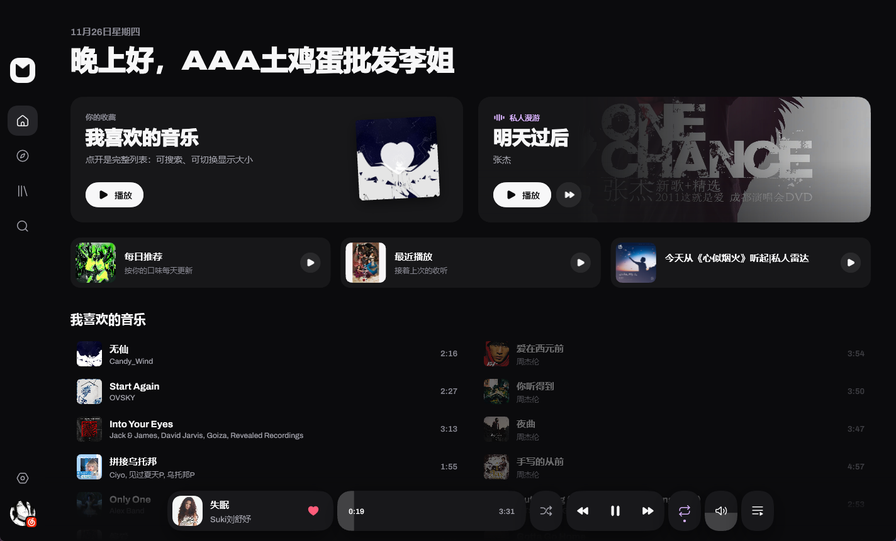
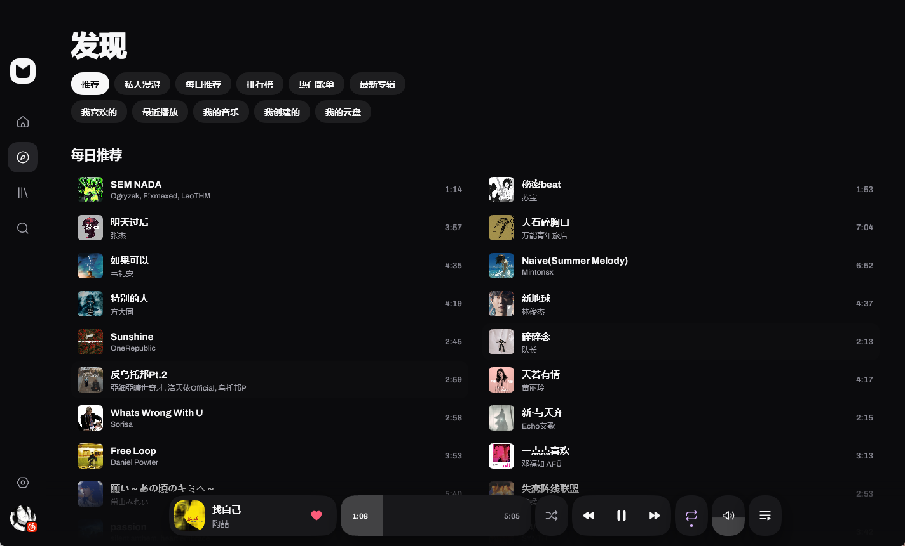

# NetEase Cloud Music · Lite

English · [简体中文](README.zh-CN.md) · [Changelog](CHANGELOG.md)


A NetEase Cloud Music source plugin for [YesPlayMusic](https://github.com/qier222/YesPlayMusic).
A UI-focused fork of [lymzzyh/ypm-plugin-netease](https://github.com/lymzzyh/ypm-plugin-netease): the entries you tap every day are collapsed into one card block on the home page, and scattered page navigation became two rows of chips. Open the app and keep listening, without hunting through a screen of recommendation cards first.

**Unofficial plugin**, not affiliated with NetEase. Streaming, sign-in, lyrics, likes and cloud drive logic come from upstream; only page composition and navigation are reworked here.

## Installation

- **Option 1 (recommended)**: YesPlayMusic → **Settings → Plugins → Install plugin**, paste the repository address: `github.com/caril633/netease-music-plugin`.
- **Option 2**: Download a ZIP from **Releases** on the repository page, extract it, then choose **Install from local folder…** and pick the folder that contains `plugin.json`.
- **Option 3**: Copy the folder into the plugin directory and restart:
  - Windows: `%APPDATA%\YesPlayMusic\plugins\`
  - macOS: `~/Library/Application Support/YesPlayMusic/plugins/`

After installing, "NetEase Cloud Music · Lite" appears under **Settings → Plugins**; hit **Reload**.
If the sidebar does not change, switch the music source to **NetEase Cloud Music · Lite** from the avatar menu first, then reload.

## Screenshots

Home: one card block plus the liked songs list.



Discover: two chip rows at the top, with the daily picks list below.



## What this fork is for

Upstream's home page is "recommended playlists + daily picks + several content blocks". Feature-complete, but day-to-day listening only touches a handful of entries while the rest compete for attention. Three changes here:

1. **Aggregate entries** — liked songs, private roam, daily picks and recently played live in one card block on the home page.
2. **Fewer levels** — groups previously expressed via `navigation` became two chip rows at the top of the page; sub pages start with a `← Back` chip.
3. **Songs first** — a track list sits right below the card block instead of a full screen of covers.

## Who it is for

| Good fit | Not a fit |
| --- | --- |
| People who want to open the app and play their likes and daily picks | People who browse charts and the playlist plaza as their home page |
| People who treat "Liked songs" as the main screen | People who need unlocking greyed tracks, proxy IP switching or downloads (not provided) |
| YesPlayMusic **3.0.0 or later** | Anyone still on 2.x (the Electron build) |

## Features

| Area | Details |
| --- | --- |
| Home | One card block + liked songs list + recommended playlist grid |
| Liked songs | 50 per page; the card opens the **native playlist page**, which has in-page search and S/M/L cover sizes |
| Private roam | Continuous radio from your listening history, with a "shuffle again" chip |
| Daily picks | 30 tracks per day, tied to your account |
| Recently played | Latest 50 tracks |
| My playlists | Only playlists you created; the fixed "Liked songs" playlist is excluded |
| Saved albums / Cloud drive | Native pages; cloud drive plays your own uploads |
| Search | Tracks / albums / playlists / artists, with suggestions |
| Playback | Standard / high / lossless / Hi-Res, with automatic fallback |
| Lyrics | Line by line |
| Likes | Heart button and context menu |
| Sign-in | QR code, session stored locally only |

## Layout

**Home**

- A greeting (changes with the time of day) and your nickname at the top.
- Card block:
  - Large cards: **Liked songs** (opens the native playlist page, with a Play button and cover) and **Private roam** (continuous radio showing the upcoming track)
  - Small rows: **Daily picks**, **Recently played**, today's **private radar** entry
- Below it: 50 liked tracks in two columns, then the recommended playlist grid.

**Discover**

- Two chip rows replace the sidebar groups:
  - Row 1: Recommended · Private roam · Daily · Charts · Hot playlists · New albums
  - Row 2: Liked · Recently played · My music · My playlists · Cloud drive
- On sub pages the first chip becomes **← Back**; the current page is highlighted and you can jump sideways.
- Pagination (liked / hot playlists / cloud drive) lives on the chip row.

## Usage

1. Click the avatar in the bottom-left corner and switch the music source to **NetEase Cloud Music · Lite**.
2. Click **Sign in** and scan the QR code with the NetEase Cloud Music mobile app.
3. Home shows the card block plus your likes; Discover shows the two chip rows.

Sign-in state lives in the local plugin data directory. Signing out only clears this plugin's session and leaves other sources untouched.

## Settings

One option for now: **quality** (follow player / standard / high / lossless / Hi-Res). If the chosen quality is unavailable it falls back automatically instead of failing playback.

## Differences from upstream

| Item | Upstream | This fork |
| --- | --- | --- |
| Home | Recommended playlists + daily picks + more blocks | One card block + liked songs + recommended playlists |
| Navigation | `navigation` in `plugin.json` | Two chip rows (`filters`) with `← Back` |
| Pagination | Carried by `links` | Moved to `filters`, since 3.0.0 never draws `links` |
| Dead code | — | Old home implementation and `morePage` fields removed |
| Strings | Partly hardcoded Chinese | All routed through `t()`, nine locales complete |

## FAQ

**Why is there no "Private roam" or "Recently played" in the sidebar?**
The 3.0.0 sidebar is fixed to Home / Discover / Library / Search / Settings. `navigation` in `plugin.json` is only shown as a capability summary on the plugin card, it does not create sidebar entries. Those entries therefore live as chips on the Discover page.

**Why can't I see "Previous / Next" buttons?**
The host parses `links` but never renders it. This fork puts pagination at the front of the chip row; tap the chip to page.

**Why are daily picks limited to 30 tracks with no paging?**
The NetEase daily endpoint has no second page. That is an API limit, not a plugin one.

**Do I need to sign in again after installing?**
Yes. This plugin's id is `netease.lite`, a separate plugin from upstream `netease`, so sessions are not shared. Later upgrades **under the same id** keep you signed in.

**Can greyed-out or region-restricted tracks play?**
No. Playback depends on your membership, purchased tracks and regional rights. This project provides no unlocking, proxy IP switching or downloading.

**I changed the page structure but nothing happened.**
The host caches home layout in `homeLayout` inside `prefs.json`. Fully quit the app (tray icon included) and start it again; clicking Reload usually only re-reads `index.js`.

**Does it work on macOS?**
Yes. The plugin is platform-agnostic; only the plugin directory path differs.

## Known limitations

These are host restrictions, not shortcuts:

- **No custom sidebar entries**, and no in-page search field, table header or cover-size switcher. For those, open the native playlist page from the "Liked songs" card.
- **No window background, theme, colours or player bar control.** The plugin protocol has no appearance capability and `Browse.imageUrl` is not rendered in 3.0.0. A window background requires patching and rebuilding the host.
- **`links` / `morePage` do nothing**, so entries and pagination use `filters`.

## Development

The plugin runs inside YesPlayMusic and needs no Node.js service. Localisation tests require Node.js 22+:

```sh
node --experimental-vm-modules --test test/localization.test.mjs
```

Current status: **29 passed / 3 skipped / 0 failed**. The three skipped cases no longer match the 1.2.2 implementation and fail upstream too. CI runs the same checks on every push.

- `index.js`: plugin exports (home, discover, playlists, playback, menus) and page composition
- `client.js`: NetEase requests, session and QR sign-in
- `models.js`: API data → plugin models
- `locales/`: UI strings for nine languages
- `docs/`: screenshots used in this README

### Repository layout

```
netease-music-plugin/
├── plugin.json          manifest (id, navigation, quality setting)
├── index.js             page composition and plugin exports
├── client.js            requests, session, QR sign-in
├── models.js            API data → models
├── i18n.js              translation helper
├── locales/             UI strings, nine languages
├── test/                localisation and page structure tests
├── docs/                README screenshots
├── CHANGELOG.md         changelog
└── LICENSE              MIT
```

## License and credits

- Based on [lymzzyh/ypm-plugin-netease](https://github.com/lymzzyh/ypm-plugin-netease) (MIT), licensed under [MIT](LICENSE).
- API reference: [NeteaseCloudMusicApiEnhanced](https://github.com/NeteaseCloudMusicApiEnhanced/api-enhanced).
- The NetEase Cloud Music name and icon belong to their respective owners; see [THIRD_PARTY_NOTICES.md](THIRD_PARTY_NOTICES.md).

## Disclaimer

This project is for learning and personal use. It does not download or redistribute any music content. Use your own account and comply with the NetEase Cloud Music terms of service; any account or copyright consequences of misuse are your own.
