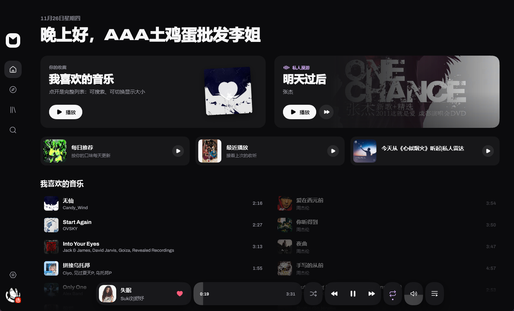
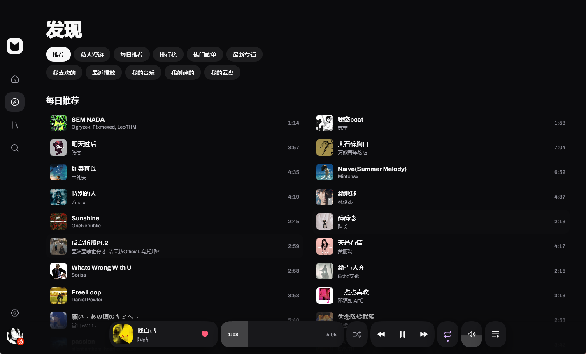

# 网易云音乐 · 简洁版

[English](README.md) · 简体中文 · [更新日志](CHANGELOG.md)


一个给 [YesPlayMusic](https://github.com/qier222/YesPlayMusic) 用的网易云音乐源插件。
基于 [lymzzyh/ypm-plugin-netease](https://github.com/lymzzyh/ypm-plugin-netease) 改造：把每天都会点的入口收进首页一张大卡，把分散的页面导航换成两排标签，打开应用就能接着听，不用先在一屏推荐卡片里找路。

**非官方插件**，与网易云音乐官方无关。取流、登录、歌词、喜欢、云盘等核心逻辑沿用上游，本项目只重做页面组织和导航方式。

## 安装

- **方式一（推荐）**：YesPlayMusic → **设置 → 插件 → 安装插件**，粘贴仓库地址：`github.com/caril633/netease-music-plugin`。
- **方式二**：从仓库右侧的 **Releases** 下载 ZIP，解压后选**从本地文件夹安装…**，选中包含 `plugin.json` 的那一层文件夹。
- **方式三**：手动放进插件目录后重启应用：
  - Windows：`%APPDATA%\YesPlayMusic\plugins\`
  - macOS：`~/Library/Application Support/YesPlayMusic/plugins/`

装好后在 **设置 → 插件** 里能看到「网易云音乐 · 简洁版」，点「重新加载」即可。
如果侧边栏没有变化，先在左下角头像里把音乐来源切成**网易云音乐 · 简洁版**，再重新加载。

## 界面预览

首页：大卡块 + 我喜欢的音乐列表。



发现页：顶部两排标签，下面是「每日推荐」列表。



## 这个分支想解决什么

上游的首页是「推荐歌单 + 每日推荐 + 若干内容块」，功能齐全，但日常听歌真正用到的就那几个入口，其余都在抢注意力。这里做了三件事：

1. **入口聚合**：我喜欢的音乐、私人漫游、每日推荐、最近播放收进首页同一张大卡。
2. **减少层级**：原本靠 `navigation` 表达的分组，改成页面顶部两排标签，子页第一个标签变 `← 返回`。
3. **歌曲优先**：大卡下面是歌曲列表，不再先铺一屏封面。

## 适合谁

| 适合 | 不适合 |
| --- | --- |
| 想打开就听收藏和日推的人 | 习惯把排行榜、歌单广场当主页逛的人 |
| 把「我喜欢的音乐」当主界面的人 | 需要解灰、代理换 IP、下载功能的人（本项目不提供） |
| YesPlayMusic **3.0.0 及以上**的用户 | 还在用 2.x（Electron 版）的用户 |

## 功能

| 能力 | 说明 |
| --- | --- |
| 首页 | 一张大卡块 + 我喜欢的音乐列表 + 推荐歌单网格 |
| 我喜欢的音乐 | 每页 50 首；从大卡进入**原生歌单页**可页内搜索、切换大/中/小图标 |
| 私人漫游 | 基于听过的歌连续推荐，标签行可「换一批」 |
| 每日推荐 | 每天 30 首，随账号更新 |
| 最近播放 | 最近 50 首 |
| 我创建的歌单 | 只列自己创建的，已排除「我喜欢的音乐」固定歌单 |
| 收藏的专辑 / 我的云盘 | 原生页面；云盘播放自己上传的歌 |
| 搜索 | 歌曲 / 专辑 / 歌单 / 歌手，带联想词 |
| 播放 | 标准 / 高音质 / 无损 / Hi-Res 可选，不可用时自动降级 |
| 歌词 | 逐行滚动 |
| 喜欢 / 收藏 | 红心与右键菜单 |
| 登录 | 手机扫码，会话只保存在本机 |

## 界面结构

**首页**

- 顶部是问候语（随时间段变化）和你的昵称。
- 大卡块：
  - 大卡：**我喜欢的音乐**（点开是原生歌单页，带「播放」按钮和封面）、**私人漫游**（电台连播，封面显示即将播放的歌曲）
  - 小行：**每日推荐**、**最近播放**、当天的**私人雷达**入口
- 大卡块下面：「我喜欢的音乐」列表 50 首，两列排布，再接推荐歌单网格。

**发现页**

- 标题「发现」，下面两排标签代替侧边栏分组：
  - 第一排：推荐 · 私人漫游 · 每日推荐 · 排行榜 · 热门歌单 · 最新专辑
  - 第二排：我喜欢的 · 最近播放 · 我的音乐 · 我创建的 · 我的云盘
- 进入子页面后第一个标签变成 **← 返回**，当前页高亮，也能横向直接切到其他页面。
- 翻页（我喜欢的 / 热门歌单 / 我的云盘）挂在标签行上。

## 使用

1. 点侧边栏左下角的头像，把音乐来源切到**网易云音乐 · 简洁版**。
2. 点**登录**，用手机网易云音乐 App 扫码并确认。
3. 回到首页：最上面是大卡块，下面是你的收藏；发现页是两排标签。

登录态保存在本机插件数据目录，退出登录只清除本插件的会话，不影响其他音源。

## 设置

目前只有一个选项：**音质**（跟随播放器 / 标准 / 高音质 / 无损 / Hi-Res）。选中的音质不可用时会自动降级，不会直接播放失败。

## 与上游的差异

| 项目 | 上游 | 本分支 |
| --- | --- | --- |
| 首页 | 推荐歌单 + 每日推荐 + 多块内容 | 一张大卡块 + 我喜欢的音乐列表 + 推荐歌单 |
| 导航 | 依赖 `plugin.json` 的 `navigation` | 顶部两排标签（`filters`），带 `← 返回` |
| 翻页 | 写在 `links` 上 | 改挂 `filters`，因为 3.0.0 不渲染 `links` |
| 未使用代码 | — | 移除了旧版首页实现与 `morePage` 字段 |
| 文案 | 部分硬编码中文 | 统一走 `t()`，九种语言齐全 |

## 常见问题

**侧边栏为什么没有「私人漫游」「最近播放」？**
3.0.0 的侧边栏固定为 首页 / 发现 / 音乐库 / 搜索 / 设置，`plugin.json` 里的 `navigation` 只作为能力说明显示在插件卡片上，不会生成侧边栏条目。所以这些入口做成了发现页的标签。

**为什么看不到「上一页 / 下一页」按钮？**
宿主会解析 `links` 但不绘制。本项目把翻页放到标签行最前面，点标签即可翻页。

**每日推荐为什么只有 30 首，不能翻页？**
网易云的日推接口本身不提供第二页，固定 30 首，这不是插件限制。

**装了之后要重新登录吗？**
要。本插件 id 是 `netease.lite`，和上游 `netease` 是两个独立插件，会话不共享。之后**同 id 覆盖升级**不会掉登录。

**灰色 / 版权受限的歌能播吗？**
不能。播放能力取决于账号会员、已购单曲和地区版权。本项目不提供解锁、代理换 IP 或下载。

**改了页面结构却不生效？**
宿主会把首页布局缓存到 `prefs.json` 的 `homeLayout`。改结构后完全退出应用（含托盘图标）再启动；只点「重新加载」通常只对 `index.js` 生效。

**macOS 能用吗？**
可以，插件本身与平台无关，只是插件目录路径不同。

## 已知限制

这些是宿主限制，不是懒得做：

- **不能自定义侧边栏**，也不能往页面里塞搜索框、表头、图标大小切换。需要这些请从「我喜欢的音乐」大卡进原生歌单页。
- **不能改窗口背景、主题、颜色、播放栏**。插件协议没有外观能力，`Browse.imageUrl` 在 3.0.0 也没被渲染；整窗背景只能改宿主源码重新编译。
- **`links` / `morePage` 无效**，所以入口和翻页统一用 `filters`。

## 开发

插件运行在 YesPlayMusic 内，不需要 Node.js 服务。跑本地化测试需要 Node.js 22+：

```sh
node --experimental-vm-modules --test test/localization.test.mjs
```

当前结果：**29 通过 / 3 跳过 / 0 失败**。跳过的 3 个用例与上游 1.2.2 的实现已经不一致（上游仓库同样失败），保留待修。CI 在每次 push 时执行同一套检查。

- `index.js`：插件导出（首页、发现、歌单、播放、菜单）与页面组织
- `client.js`：网易云接口请求、会话与二维码登录
- `models.js`：接口数据 → 插件模型
- `locales/`：九种语言的界面文案
- `docs/`：README 用的界面截图

### 目录结构

```
netease-music-plugin/
├── plugin.json          插件清单（id、页面导航、音质设置）
├── index.js             页面组织与插件导出
├── client.js            接口请求、会话、扫码登录
├── models.js            数据模型转换
├── i18n.js              翻译函数
├── locales/             九种语言文案
├── test/                本地化与页面结构测试
├── docs/                README 截图
├── CHANGELOG.md         更新日志
└── LICENSE              MIT
```

## 许可与致谢

- 基于 [lymzzyh/ypm-plugin-netease](https://github.com/lymzzyh/ypm-plugin-netease)（MIT）修改，遵循 [MIT](LICENSE)。
- 接口参考 [NeteaseCloudMusicApiEnhanced](https://github.com/NeteaseCloudMusicApiEnhanced/api-enhanced)。
- 网易云音乐的名称与图标归其权利人所有，详见 [THIRD_PARTY_NOTICES.md](THIRD_PARTY_NOTICES.md)。

## 免责声明

本项目仅用于学习和个人使用，不提供任何音乐内容的下载或分发。请使用自己的账号并在遵守网易云音乐服务条款的前提下使用；因使用不当产生的账号或版权问题由使用者自行承担。
